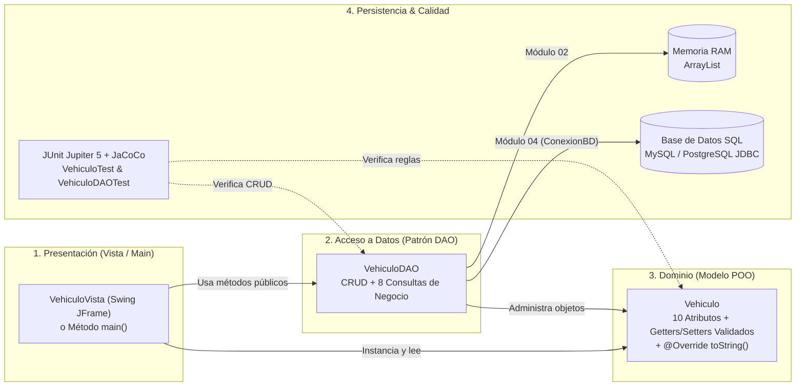

# ☕ Curso Interactivo de Arquitectura en Java · Café y Código

[](https://curso-java.cafeycodigo.org)
[](https://openjdk.org/)
[](https://maven.apache.org/)
[](https://curso-java.cafeycodigo.org/junit.html)
[](https://curso-java.cafeycodigo.org/base-datos.html)

Repositorio oficial y guía interactiva paso a paso para aprender **Programación Orientada a Objetos (POO) y Arquitectura en Capas en Java** desde cero hasta persistencia en bases de datos relacionales con **Maven** y **Apache NetBeans**.

🌐 **Explora la plataforma interactiva (Web y Móvil):** [**https://curso-java.cafeycodigo.org**](https://curso-java.cafeycodigo.org)

---

## 🧭 Módulos de Aprendizaje Interactivos

| Módulo | Enlace Directo | Qué aprenderás | Práctica |
| :--- | :--- | :--- | :--- |
| **01 · Modelo POO** | [`/index.html`](https://curso-java.cafeycodigo.org/index.html) | Variables, tipos de datos, encapsulamiento (`private` sin `final`), constructor vacío y con parámetros, `get` / `set` con validación (`IllegalArgumentException`) y `@Override toString()`. | Simulador de Setters en vivo + **6 ejercicios resueltos** |
| **02 · Patrón DAO** | [`/proyecto.html`](https://curso-java.cafeycodigo.org/proyecto.html) | Colecciones `ArrayList<T>`, copia defensiva, las 5 operaciones **CRUD** (`guardar`, `buscar`, `listar`, `actualizar`, `eliminar`), **8 consultas de negocio/reporte** e integración con `JTable` en Swing. | Laboratorio CRUD + Explorador IDE + **6 ejercicios resueltos** |
| **03 · JUnit 5 & JaCoCo** | [`/junit.html`](https://curso-java.cafeycodigo.org/junit.html) | Pruebas unitarias automatizadas con JUnit Jupiter 5, patrón **AAA (Arrange, Act, Assert)**, `assertEquals`, `assertSame`, `assertThrows` con lambdas `() ->` y cobertura con **JaCoCo**. | Simulador de Suite JUnit con inyección de bugs + **6 ejercicios** |
| **04 · Base de Datos JDBC** | [`/base-datos.html`](https://curso-java.cafeycodigo.org/base-datos.html) | Evolución del DAO hacia SQL con **MySQL Local** y **Supabase (PostgreSQL)**: `ConexionBD`, `PreparedStatement` (`?`), `ResultSet`, `try-with-resources` y manejo de `SQLException`. | Selector MySQL/Supabase + Simulador SQL + **6 ejercicios** |

---

## 🔄 6 Dominios de Estudio Dinámicos

En la guía web puedes cambiar el dominio en cualquier momento y **todo el código Java, tablas, simuladores y los 24 ejercicios** se adaptan automáticamente al contexto elegido:

- 🚗 [**Vehículo (Automotora)**](https://curso-java.cafeycodigo.org/index.html?contexto=vehiculo) — Clave única: `Patente` (`ABCD12`)
- 🐾 [**Animal (Clínica Veterinaria)**](https://curso-java.cafeycodigo.org/index.html?contexto=animal) — Clave única: `Chip` (`CHIP-2048`)
- 🪪 [**Persona (Registro de Personas)**](https://curso-java.cafeycodigo.org/index.html?contexto=persona) — Clave única: `RUT` (`12345678-9`)
- 🎓 [**Estudiante (Gestión Académica)**](https://curso-java.cafeycodigo.org/index.html?contexto=estudiante) — Clave única: `Matrícula` (`MAT-2026`)
- 📦 [**Producto (Catálogo Comercial)**](https://curso-java.cafeycodigo.org/index.html?contexto=producto) — Clave única: `SKU` (`PROD-1001`)
- 💻 [**Dispositivo (Inventario Tecnológico)**](https://curso-java.cafeycodigo.org/index.html?contexto=dispositivo) — Clave única: `UUID` (`550e8400-e29b-41d4-a716-446655440000`)

---

## 🏗️ Arquitectura en Capas del Proyecto



---

## 📂 Estructura del Repositorio

```text
Automotora/
├── Automotora/                  # Módulo 01: Proyecto Maven con Modelo POO y Vista Swing
│   ├── pom.xml
│   └── src/main/java/com/mycompany/automotora/
│       ├── Automotora.java
│       ├── modelo/Vehiculo.java
│       └── vista/VehiculoVista.java (.form)
│
├── AutomotoraDAO/               # Módulo 02 y 03: Proyecto Maven con Modelo, DAO (13 métodos) y Vista Swing
│   ├── pom.xml
│   └── src/main/java/com/mycompany/automotoradao/
│       ├── AutomotoraDAO.java
│       ├── dao/VehiculoDAO.java
│       ├── modelo/Vehiculo.java
│       └── vista/VehiculoVista.java (.form)
│
├── AutomotoraDB/                # Módulo 04: Punto de partida Maven para persistencia con Base de Datos (JDBC)
│   ├── pom.xml
│   └── src/main/java/com/mycompany/automotoradb/
│       └── AutomotoraDB.java
│
├── _page/                       # Plataforma web educativa publicada en https://curso-java.cafeycodigo.org
│   ├── index.html               # Lección 01: Modelo POO
│   ├── proyecto.html            # Lección 02: Patrón DAO y Colecciones ArrayList
│   ├── junit.html               # Lección 03: Testing con JUnit 5 y Cobertura JaCoCo
│   ├── base-datos.html          # Lección 04: Persistencia JDBC con MySQL y Supabase PostgreSQL
│   ├── contextos.js             # Motor dinámico de los 6 dominios, simuladores y ejercicios
│   ├── proyectos.js             # Generador de proyectos Java y explorador de código IDE
│   ├── junit.js                 # Simulador de pruebas unitarias JUnit 5
│   ├── base-datos.js            # Generador de código JDBC/SQL y simulador relacional
│   ├── guia.css                 # Sistema de diseño responsivo (Mobile-First + Desktop)
│   ├── sitemap.xml              # Mapa del sitio XML para motores de búsqueda
│   ├── robots.txt               # Directivas de indexación SEO
│   └── CNAME                    # Dominio personalizado: curso-java.cafeycodigo.org
│
└── .github/workflows/pages.yml  # CI/CD: Despliegue automático de _page a GitHub Pages
```

---

## 💻 Resumen de Código Java por Capa

### 1. El Modelo POO (`Vehiculo.java`)
Atributos privados **sin `final`**, constructor vacío, constructor con parámetros que delega en los setters validados, métodos `get` / `set` y `@Override public String toString()`:

```java
public class Vehiculo {
    private String patente;
    private String modelo;

    public Vehiculo() {
    }

    public Vehiculo(String patente, String modelo) {
        this.patente = patente;
        this.modelo = modelo;
    }

    public String getPatente() {
        return patente;
    }

    public void setPatente(String patente) {
        this.patente = patente;
    }

    public String getModelo() {
        return modelo;
    }

    public void setModelo(String modelo) {
        this.modelo = modelo;
    }

    @Override
    public String toString() {
        return "Vehiculo{" + "patente=" + patente + ", modelo=" + modelo + '}';
    }
}
```

> En el proyecto completo (`Automotora` y `AutomotoraDAO`), `Vehiculo` gestiona **10 atributos** (`codigo`, `patente`, `marca`, `modelo`, `anio`, `electrico`, `disponible`, `tipo`, `color`, `transmision`) validando formato de 8 dígitos numéricos, patente de 6 caracteres y año `>= 2015`.

### 2. El Patrón DAO (`VehiculoDAO.java`)
Encapsula un `ArrayList<Vehiculo>` privado y expone **13 métodos públicos**:
- **5 Operaciones CRUD:** `guardar(Vehiculo)`, `buscar(String patente)`, `listar()`, `actualizar(Vehiculo)` y `eliminar(String patente)`.
- **8 Consultas y Reportes:** `listarElectricos()`, `listarDisponibles()`, `listarPorMarca(String)`, `listarPorTipo(String)`, `listarPorAnio(int)`, `listarDesdeAnio(int)`, `contarTotal()` y `contarDisponibles()`.

---

## 🚀 Cómo Ejecutar los Proyectos Localmente

### Requisitos previos
- **JDK 17** o superior (`java -version`)
- **Apache Maven 3.9+** (`mvn -version`)
- **Apache NetBeans** (opcional, recomendado para editar los formularios Swing `.form`)

### Comandos rápidos con Maven

```bash
# 1. Compilar y ejecutar las pruebas unitarias en AutomotoraDAO
mvn -f AutomotoraDAO/pom.xml test

# 2. Generar el reporte HTML de cobertura JaCoCo (target/site/jacoco/index.html)
mvn -f AutomotoraDAO/pom.xml clean verify
```

### Previsualizar la Guía Web (`_page`) localmente

Puedes abrir `_page/index.html` directamente en tu navegador o levantar un servidor local estático:

```bash
npx serve _page
```

---

## 🌐 Despliegue Automático (GitHub Pages)

Cada `push` a la rama `main` que modifique archivos dentro de `_page/` activa el flujo de trabajo [`.github/workflows/pages.yml`](.github/workflows/pages.yml), publicando automáticamente la guía actualizada en:

👉 [**https://curso-java.cafeycodigo.org**](https://curso-java.cafeycodigo.org)

---

## 📄 Licencia y Créditos

Desarrollado con fines educativos por **Café y Código** ([`@cafeycodigo`](https://github.com/cafeycodigo)) para el aprendizaje práctico de **Java 17, POO, Patrón DAO, JUnit 5 y Bases de Datos SQL con JDBC**.

